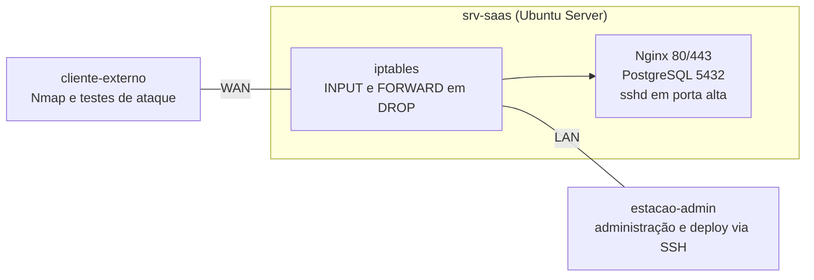

# Infraestrutura Segura para uma Empresa de Software como Serviço (SaaS)

**Trabalho Final de Segurança da Informação 2026 | Grupo 7**

| | |
|---|---|
| Instituição | Instituto Federal Goiano, Campus Ceres |
| Curso | Bacharelado em Sistemas de Informação, 6º período |
| Disciplina | Segurança da Informação |
| Professor | Roitier Campos Gonçalves |
| Integrantes | Tiago Cardoso Ferreira, Luanna Fernandes, Felipe Ramos |
| Prazo de entrega | 26/11/2026 |
| Valor | 4 pontos (1 de parte teórica/GIT e 3 de parte prática) + 1 ponto extra de desenvolvimento em sala |

> Este README tem duas funções. Até a entrega, é o **plano de execução** do grupo (o que o trabalho precisa ter e em que ordem construir). Na entrega, passa a ser a **documentação oficial** do projeto. Seções marcadas com *(a preencher na Etapa N)* são completadas conforme o trabalho avança.

---

## Sumário

1. [Contexto e objetivo](#1-contexto-e-objetivo)
2. [O que o trabalho precisa ter](#2-o-que-o-trabalho-precisa-ter)
3. [Decisões de arquitetura](#3-decisões-de-arquitetura)
4. [Estrutura do repositório](#4-estrutura-do-repositório)
5. [Plano de desenvolvimento](#5-plano-de-desenvolvimento)
6. [Fluxo de trabalho com Git](#6-fluxo-de-trabalho-com-git)
7. [Como configurar e executar](#7-como-configurar-e-executar)
8. [Evidências](#8-evidências)
9. [Riscos e mitigação](#9-riscos-e-mitigação)
10. [Pendências e decisões abertas](#10-pendências-e-decisões-abertas)
11. [Definição de pronto](#11-definição-de-pronto)
12. [Referências](#12-referências)

---

## 1. Contexto e objetivo

Uma empresa de **Software como Serviço (SaaS)** contratou a equipe de consultoria após um incidente cibernético. O ambiente do segmento é **multi-tenant** (vários clientes compartilhando a mesma plataforma), com **deploy contínuo via SSH** e **gestão de bancos de dados relacionais**.

O objetivo é reformular a infraestrutura de TI local, rodando **Ubuntu Server**, garantindo os pilares de **Confidencialidade, Integridade e Disponibilidade (CID)**, além de rastreabilidade e aderência à Política de Segurança da Informação (PSI).

**Dentro do escopo:** relatório de ameaças, capítulo da PSI, rede e roteamento, firewall com iptables, hardening de SSH e do sistema operacional, GPG, verificação de integridade com SHA-256, testes e evidências.

**Fora do escopo:** desenvolver o produto SaaS. Os serviços (servidor web e banco de dados) existem apenas para que haja portas e tráfego reais a proteger. A nota está na segurança da infraestrutura, não na aplicação.

---

## 2. O que o trabalho precisa ter

Cada item abaixo vem do enunciado e aponta para a etapa do plano que o atende. Marque a caixa quando o item estiver pronto **e** com evidência registrada.

### 2.1 Requisitos técnicos

**Módulo 1: Fundamentos e alinhamento estratégico**
- [ ] **R1.1** Relatório de Ameaças: 2 vetores de ataque específicos do segmento SaaS, com base nas diretrizes do NIC.br e no Relatório Global de Ameaças CrowdStrike 2026, com medidas preventivas fundamentadas (Etapa 3)
- [ ] **R1.2** Capítulo da PSI cobrindo controle de acesso, auditoria e uso aceitável, coerente com o cenário (Etapa 4)

**Módulo 2: Rede, firewall e hardening**
- [ ] **R2.1** IP estático nas interfaces interna (LAN) e externa (WAN) do Ubuntu Server e tabela de roteamento estático ajustada (Etapa 2)
- [ ] **R2.2** Script `firewall.sh` com política padrão DROP em INPUT e FORWARD (Etapa 5)
- [ ] **R2.3** Apenas as portas estritamente necessárias ao segmento liberadas (Etapa 5)
- [ ] **R2.4** Proteção contra varredura de portas e rate limiting contra força bruta e DoS (Etapa 5)
- [ ] **R2.5** SSH: porta alterada, login direto de root bloqueado, `AllowUsers`, autenticação exclusiva por chave pública/privada (Etapa 6)
- [ ] **R2.6** Sistema operacional: permissões em `/etc/` e `/var/log/`, remoção de pacotes desnecessários e atualização de segurança (Etapa 7)

**Módulo 3: Comunicação segura e auditabilidade**
- [ ] **R3.1** Chaves GPG geradas e assinadas para a equipe de administradores, com troca criptografada de um arquivo de configuração sensível (credenciais ou tokens de API) (Etapa 8)
- [ ] **R3.2** Script que calcula e valida periodicamente o SHA-256 de `/etc/passwd`, `/etc/shadow` e das regras salvas do iptables, com alerta visual ou em log em caso de alteração (Etapa 9)

### 2.2 Entregáveis

- [ ] **E1** Relatório Técnico Unificado em **PDF**: justificativa da arquitetura baseada no segmento e na literatura da disciplina, diagrama detalhado da topologia, explicação técnica de **cada** regra de iptables e de **cada** parâmetro do `sshd_config` (Etapa 11)
- [ ] **E2** Scripts funcionais: `firewall.sh` e script de verificação de integridade SHA-256 (Etapas 5 e 9)
- [ ] **E3** Arquivo de exportação da chave pública GPG do grupo (Etapa 8)
- [ ] **E4** Evidências de teste, com capturas de tela e logs (Etapa 10):
  - [ ] Nmap **antes** e **depois** do firewall
  - [ ] Tentativa de SSH como root bloqueada
  - [ ] Decifragem do arquivo GPG
  - [ ] Detecção automática de alteração via SHA-256

### 2.3 Critérios de avaliação que moldam o plano

| Critério do enunciado | Consequência para o grupo |
|---|---|
| Todos os membros apresentam; ninguém entra no grupo depois | Os três precisam dominar o trabalho inteiro, não só a sua parte |
| Arguição individual sobre código e documentação; se um não demonstrar pleno conhecimento, o grupo é penalizado | Nenhuma linha de código ou de configuração entra sem que o autor e o revisor consigam explicá-la |
| Código no GitHub passa por detecção de similaridade (MOSS; exemplo de limite: 20%); acima do limite, nota zero sem reavaliação | Scripts escritos e adaptados pelo grupo, com estrutura e comentários próprios; fonte citada no cabeçalho quando houver base externa |
| Testes de robustez e segurança em ambiente do professor (penetração básica e varredura de vulnerabilidades) | A Etapa 10 reproduz esses ataques antes da apresentação |
| Documentação no GitHub é critério de peso: README detalhado, diagramas de arquitetura, comentários em padrão consistente | Guia de estilo na Etapa 0 e revisão de documentação em todo PR |
| O professor pode restringir bibliotecas e frameworks, exigindo implementação do zero | Somente iptables e seus módulos nativos; sem `ufw`, `fail2ban` ou similares |
| Faltas, atrasos e saídas antecipadas afetam o ponto extra | Presença nas aulas de desenvolvimento é parte do plano |
| Ordem de apresentação: 3, 7, 10, 2, 8, 4, 6, 5, 9, 1 | O Grupo 7 apresenta em **segundo lugar**; o congelamento de código é antecipado (Etapa 10) |

---

## 3. Decisões de arquitetura

### 3.1 Topologia

O servidor Ubuntu atua como **gateway e firewall** entre a rede externa (WAN) e a rede interna (LAN), e também hospeda os serviços do segmento. O diagrama abaixo é o rascunho inicial; a versão detalhada (IPs finais, interfaces, fluxos permitidos e bloqueados) é produzida na Etapa 2 e refinada na Etapa 11.



### 3.2 Parâmetros do laboratório

Valores sugeridos. Os definitivos ficam em `config/lab.env` e são a **única fonte** usada pelos scripts.

| Parâmetro | Valor sugerido | Observação |
|---|---|---|
| Sistema operacional | Ubuntu Server 24.04 LTS | Confirmar a versão do ambiente de testes do professor e usar a mesma |
| LAN | `10.10.10.0/24`, servidor em `10.10.10.1` | Rede interna do hipervisor, sem saída direta |
| WAN | Faixa da rede virtual com acesso à Internet | Necessária para as atualizações de segurança (R2.6); IP **estático** (R2.1) |
| Rota estática adicional | `10.10.20.0/24` via `10.10.10.2` | Exemplo: rede de CI/deploy atrás de um roteador da LAN; demonstra roteamento estático além da rota default |
| Porta SSH | Porta alta definida pelo grupo | Evitar 22 e 2222 |
| Banco de dados | PostgreSQL, porta 5432 | MySQL é alternativa, desde que a escolha seja justificada |
| Contas | Uma conta administrativa **nominal** por integrante + conta de serviço `deploy` | Rastreabilidade: nenhuma conta compartilhada |

### 3.3 Política de portas e acessos (segmento SaaS)

Base do firewall (Etapa 5). Tudo que não está na tabela fica bloqueado.

| Serviço | Porta | Origem permitida | Justificativa |
|---|---|---|---|
| HTTPS (aplicação multi-tenant) | 443/tcp | Qualquer origem | Serviço público da plataforma |
| HTTP | 80/tcp | Qualquer origem | Apenas para redirecionar a HTTPS |
| SSH (administração e deploy) | porta alta/tcp | Somente LAN de gerência e origem autorizada de deploy, com limite de novas conexões por IP | Reduz exposição do acesso privilegiado |
| PostgreSQL | 5432/tcp | Somente LAN | O banco **nunca** é acessível pela WAN |
| ICMP echo | n/a | Limitado por taxa | Permite diagnóstico sem facilitar varredura nem inundação |
| Tráfego de resposta | n/a | `ESTABLISHED,RELATED` | Firewall stateful (Aula 08) |
| Pacotes `INVALID` | n/a | Descartar | Aula 08 |

### 3.4 Princípios

- **Política padrão DROP** e liberações explícitas, com justificativa registrada (Aula 09).
- **Privilégio mínimo** e **defesa em profundidade**: o firewall não é a única barreira (Aula 08).
- **Do zero:** sem ferramentas prontas que escondam o mecanismo.
- **Reprodutível e idempotente:** qualquer integrante reconstrói o laboratório do zero seguindo apenas este README, e rodar um script duas vezes não duplica regras.
- **Nenhum segredo real no Git.** Credenciais e tokens usados nos exemplos são sempre fictícios.
- **Tudo explicável:** cada regra, parâmetro e linha de script tem uma justificativa escrita.

---

## 4. Estrutura do repositório

```
.
|-- README.md
|-- .gitignore
|-- .github/
|   +-- pull_request_template.md
|-- config/
|   +-- lab.env                  # IPs, portas, usuários (sem segredos)
|-- docs/
|   |-- equipe.md                # integrantes, trilhas e responsabilidades
|   |-- guia-de-estilo.md        # padrão de comentários e de commits
|   |-- decisoes.md              # registro de decisões e justificativas
|   |-- arquitetura/             # diagramas e descrição do laboratório e da rede
|   |-- ameacas/                 # relatório de ameaças
|   |-- psi/                     # capítulo da PSI
|   |-- firewall/                # matriz de regras
|   |-- hardening/               # SSH e sistema operacional (antes/depois)
|   |-- criptografia/            # GPG
|   |-- integridade/             # verificação SHA-256
|   |-- relatorio/               # fonte e PDF do relatório técnico unificado
|   +-- defesa/                  # roteiro da apresentação e banco de perguntas
|-- infra/
|   |-- netplan/                 # 01-netcfg.yaml
|   |-- sshd/                    # configuração do sshd
|   +-- servicos/                # Nginx e PostgreSQL do laboratório
|-- scripts/
|   |-- lib/                     # funções compartilhadas
|   |-- firewall.sh
|   |-- hardening-ssh.sh
|   |-- hardening-so.sh
|   +-- verifica-integridade.sh
|-- gpg/
|   |-- chaves-publicas/         # somente chaves PÚBLICAS (.asc)
|   +-- exemplo/                 # arquivo fictício cifrado e instruções
|-- tests/                       # scripts de teste positivo e negativo
+-- evidencias/
    +-- README.md                # índice das evidências
```

---

## 5. Plano de desenvolvimento

### 5.1 Cronograma

Hoje é 07/11/2026 e o prazo é 26/11/2026 (quinta-feira): **19 dias**. Como o Grupo 7 é o segundo a apresentar, o código congela no dia 21/11. O dia 20/11 é feriado nacional (Consciência Negra) e o dia 15/11 é domingo; ambos contam como folga na prática, mas não como dias de aula.

| Fase | Período | Etapas | Saída da fase |
|---|---|---|---|
| 0. Fundação | 07 a 09/11 | 0 e 1 | Repositório organizado e laboratório de pé, com snapshots |
| 1. Rede e linha de base | 10 a 11/11 | 2 | Rede estática, rotas, serviços simulados e **Nmap "antes"** |
| 2. Documentos de base (paralelo) | 10 a 14/11 | 3 e 4 | Relatório de ameaças e capítulo da PSI |
| 3. Perímetro e acesso | 12 a 17/11 | 5, 6 e 7 | Firewall, SSH e SO endurecidos |
| 4. Criptografia e integridade | 14 a 18/11 | 8 e 9 | GPG e verificação SHA-256 |
| 5. Testes | 18 a 21/11 | 10 | Evidências completas e **congelamento do código em 21/11** |
| 6. Fechamento | 21 a 24/11 | 11 e 12 | Relatório PDF e repositório final |
| 7. Ensaio | 24 e 25/11 | 13 | Grupo pronto para a arguição |
| Entrega | 26/11 | n/a | Repositório e relatório entregues |

### 5.2 Trilhas e revisão cruzada

Cada integrante é responsável por uma trilha, mas **todo PR é revisado por outro integrante**, que precisa ler e executar o que foi entregue. Isso distribui o conhecimento e prepara a arguição individual.

| Trilha | Integrante | Foco | Etapas | Revisores (conforme cada etapa) |
|---|---|---|---|---|
| **A** | Tiago | Laboratório, rede e firewall | 1, 2, 3, 5 | B e C |
| **B** | Luanna | Acesso, hardening e PSI | 4, 6, 7 | C e A |
| **C** | Felipe | Criptografia, integridade e relatório | 8, 9, 11 | A e B |

As etapas 0, 10, 12 e 13 são de **todos**. O registro das trilhas fica em `docs/equipe.md`.

### 5.3 Etapas

Cada etapa tem **entregáveis**, **critério de aceite** (a etapa só fecha se todos forem atendidos) e **perguntas de defesa** (qualquer integrante deve saber responder).

---

#### Etapa 0: Alinhamento e repositório
**Responsável:** todos | **Prazo:** 08/11

- **Objetivo:** base do projeto pronta para os três trabalharem sem conflito.
- **Entregáveis:** repositório criado; estrutura de pastas da seção 4; `.gitignore`; `config/lab.env` (modelo); `docs/guia-de-estilo.md` (cabeçalho padrão de script, comentários em português, nomes de variáveis, formato de commit); `.github/pull_request_template.md`; uma issue por etapa com o checklist de aceite; `main` protegida (PR com uma aprovação); `docs/equipe.md` com os integrantes e as trilhas (A: Tiago, B: Luanna, C: Felipe).
- **Aceite:** cada integrante clonou, criou branch, abriu PR e teve aprovação de outro; o `git log` mostra os três autores com o e-mail vinculado ao GitHub.
- **Defesa:** como o grupo dividiu o trabalho e revisa as entregas? Onde ficam registradas as decisões?

---

#### Etapa 1: Laboratório virtual
**Responsável:** A | **Revisor:** B | **Prazo:** 09/11

- **Objetivo:** ambiente reproduzível com três máquinas: `srv-saas` (Ubuntu Server com duas interfaces), `cliente-externo` (Linux com Nmap, no lado WAN) e `estacao-admin` (lado LAN).
- **Entregáveis:** `docs/arquitetura/laboratorio.md` com hipervisor, versão do Ubuntu, redes virtuais, recursos e passo a passo; snapshot `base-limpa` de cada VM.
- **Aceite:** `cliente-externo` alcança a WAN do servidor; `estacao-admin` alcança a LAN; o servidor acessa a Internet pela WAN para atualizações; o console de cada VM permite recuperação caso o acesso remoto seja bloqueado.
- **Evidências:** `ip -br addr` e `ip route` de cada máquina.
- **Defesa:** por que duas interfaces e duas redes? Por que o servidor precisa atuar como gateway?

---

#### Etapa 2: Rede, rotas e serviços simulados (R2.1)
**Responsável:** A | **Revisor:** C | **Prazo:** 11/11

- **Objetivo:** servidor com IP estático em LAN e WAN, roteamento estático e serviços do segmento no ar, **antes de qualquer regra de firewall**.
- **Entregáveis:**
  - `infra/netplan/01-netcfg.yaml` com `dhcp4: no`, endereços, gateway, DNS e rota estática adicional (Aula "Configuração de IP no Ubuntu Server").
  - Encaminhamento de pacotes habilitado de forma persistente (`net.ipv4.ip_forward=1`).
  - Nginx com TLS autoassinado (443) e PostgreSQL (5432) escutando na LAN, em `infra/servicos/`.
  - `docs/arquitetura/rede.md` explicando cada linha do netplan e a tabela de rotas (rota default, rota para rede, `next hop`, Aula 02).
  - Diagrama da topologia (primeira versão detalhada) em `docs/arquitetura/`.
  - **Linha de base "antes":** varredura Nmap do `cliente-externo` contra o servidor **sem firewall**.
- **Aceite:** `netplan apply` sem erros; `ip route` mostra a rota default e a estática; a configuração sobrevive a reinício; o Nmap lista as portas dos serviços; snapshot `pre-firewall` criado.
- **Atenção:** a varredura "antes" precisa ser feita agora. Depois do firewall ela não pode mais ser reproduzida e o item E4 ficaria sem metade da evidência.
- **Defesa:** o que é `next hop`? Qual a diferença entre rota estática e dinâmica? Por que habilitar `ip_forward`? Qual a diferença entre um host multi-homed e um roteador?

---

#### Etapa 3: Relatório de Ameaças (R1.1)
**Responsável:** A | **Revisor:** B | **Prazo:** 14/11 | *trilha de documentação, em paralelo*

- **Objetivo:** identificar 2 vetores de ataque específicos de SaaS multi-tenant, fundamentá-los nas fontes exigidas e ligar cada medida preventiva a um controle realmente implementado no laboratório.
- **Candidatos a avaliar** (a decisão final é do grupo e deve ser justificada em `docs/decisoes.md`):

| Vetor | Por que se aplica ao SaaS | Ponto de apoio nas fontes (conferir no original) | Controle no laboratório |
|---|---|---|---|
| Abuso de credenciais válidas e de acesso administrativo ou de deploy (inclui força bruta e chaves vazadas) | Contas privilegiadas e chaves de deploy dão acesso a todos os tenants | CrowdStrike 2026, resumo executivo: 82% das detecções sem malware e abuso de contas válidas em 35% dos incidentes na nuvem (págs. 3 e 5); NIC.br: força bruta (Aula 01) | SSH só por chave, `AllowUsers`, rate limiting, GPG na troca de segredos |
| Comprometimento da cadeia de suprimentos de software e do pipeline de deploy | A confiança em atualizações e em deploy automatizado é o caminho do atacante | CrowdStrike 2026: exploração da confiança em fornecedores, software legítimo e mecanismos de atualização (págs. 2 e 3) | Verificação SHA-256, assinatura GPG, conta `deploy` restrita |
| Alternativas: varredura e DDoS (disponibilidade); exposição do banco ou vazamento entre tenants | | NIC.br (Aula 01) | Firewall e segmentação |

- **Entregáveis:** `docs/ameacas/relatorio-ameacas.md` com contexto do segmento, descrição de cada vetor (cadeia do ataque, impacto em C, I ou D), medidas preventivas e uma tabela **vetor, medida, arquivo do laboratório, evidência**.
- **Aceite:** toda medida aponta para um controle existente no repositório; todo número ou citação foi conferido na fonte e tem página; referências em ABNT.
- **Observação:** o material da disciplina traz apenas o **resumo executivo** do relatório da CrowdStrike. Para citar algo além dele, obtenha o relatório completo.
- **Defesa:** por que esses dois vetores e não os outros? Que pilar do CID cada um ataca? Qual controle técnico mitiga cada um?

---

#### Etapa 4: Política de Segurança da Informação (R1.2)
**Responsável:** B | **Revisor:** C | **Prazo:** 14/11 | *trilha de documentação, em paralelo*

- **Objetivo:** capítulo de PSI coerente com o cenário, em que cada diretriz tem um controle técnico ou procedimento correspondente.
- **Entregáveis:** `docs/psi/capitulo-psi.md` com objetivo, escopo, responsabilidades e três blocos de diretrizes:
  - **Controle de acesso:** contas nominais, privilégio mínimo, segregação entre tenants, acesso privilegiado, chaves SSH, revisão periódica de acessos.
  - **Auditoria:** logs de autenticação, retenção, proteção contra alteração, tratamento dos alertas de integridade.
  - **Uso aceitável:** uso do ambiente de produção, credenciais, proibições e sanções.
- **Aceite:** nenhuma diretriz sem controle ou procedimento correspondente; nenhuma contradição com o firewall, o SSH ou o hardening; normas e livro da disciplina citados com a edição indicada.
- **Defesa:** qual diretriz da PSI é cumprida por qual configuração? Como a PSI trata um alerta de alteração em `/etc/shadow`?

---

#### Etapa 5: Firewall com iptables (R2.2, R2.3, R2.4)
**Responsável:** A | **Revisor:** B | **Prazo:** 16/11

- **Objetivo:** perímetro com política restritiva, liberando somente o que a seção 3.3 define.
- **Entregáveis:**
  - `scripts/firewall.sh`, parametrizado por `config/lab.env`, seguindo a ordem da apostila: módulos e `ip_forward`, limpeza (`-F`, `-X`, `-Z`), políticas, loopback e `ESTABLISHED,RELATED`, serviços.
  - Conteúdo mínimo: DROP em INPUT e FORWARD; descarte de `INVALID`; portas da seção 3.3 com origem restrita; NAT e encaminhamento LAN para WAN; bloqueio de combinações inválidas de flags TCP (NULL, XMAS, SYN+FIN); detecção de varredura com o módulo `recent`; `LOG` com `--limit` e prefixo; rate limiting de novas conexões SSH por IP e de SYN; ICMP limitado.
  - Persistência: regras salvas em arquivo (esse arquivo é monitorado na Etapa 9) e carregadas na inicialização.
  - `docs/firewall/matriz-de-regras.md`: para **cada regra**, tabela e chain, comando, finalidade, ameaça mitigada e o teste que a comprova.
- **Restrição:** apenas iptables e módulos nativos do netfilter.
- **Segurança operacional:** ao testar por SSH, programar uma restauração automática das regras e manter uma segunda sessão aberta; o console da VM é o plano de recuperação.
- **Aceite:** `iptables -S` mostra DROP em INPUT e FORWARD; HTTPS, SSH autorizado e banco pela LAN continuam funcionando; banco pela WAN e porta 22 falham; executar duas vezes não duplica regras; as regras persistem após reinício; `shellcheck` sem erros graves.
- **Defesa:** por que firewall stateful? Em que chains um pacote passa até o servidor e até a LAN? DROP ou REJECT na WAN e na LAN, e por quê (Aula 09)? Como a regra do SSH reduz a força bruta?

---

#### Etapa 6: Hardening do SSH (R2.5)
**Responsável:** B | **Revisor:** C | **Prazo:** 16/11

- **Objetivo:** acesso remoto privilegiado só por quem deve, só por chave, só de onde deve.
- **Entregáveis:**
  - `infra/sshd/` com a configuração e `scripts/hardening-ssh.sh` que a aplica.
  - Chaves por integrante e para o `deploy` (no repositório, no máximo as **públicas**).
  - `docs/hardening/ssh.md`: tabela **diretiva, valor, risco mitigado** para cada parâmetro.
  - Mínimo: porta não padrão, `PermitRootLogin no`, `AllowUsers` (contas nominais e `deploy`), `PasswordAuthentication no`, `PubkeyAuthentication yes`. Complementos (`MaxAuthTries`, `LoginGraceTime`, `X11Forwarding`, `AllowTcpForwarding` e restrição do `deploy` por origem) só entram se alguém do grupo souber justificá-los.
- **Atenção (Ubuntu 24.04):** o `sshd` pode ser iniciado por socket (`ssh.socket`) e, nesse caso, ignorar a diretiva `Port`. Conferir com `ss -tlnp` em qual porta ele realmente escuta. Validar com `sshd -t` antes de reiniciar e manter a sessão atual aberta até testar em uma segunda.
- **Aceite:** login por chave nominal funciona na nova porta; root recusado; senha recusada; usuário fora de `AllowUsers` recusado; porta 22 fechada; firewall ajustado à nova porta.
- **Evidências:** tentativa de SSH como root bloqueada (saída do cliente e linha correspondente em `/var/log/auth.log`).
- **Defesa:** mudar a porta é um controle de segurança? Por que chave e não senha? O que `AllowUsers` faz que o firewall não faz?

---

#### Etapa 7: Hardening do sistema operacional (R2.6)
**Responsável:** B | **Revisor:** A | **Prazo:** 17/11

- **Objetivo:** reduzir a superfície de ataque do servidor (Aulas 03 e 04).
- **Entregáveis:** `scripts/hardening-so.sh` e `docs/hardening/so.md` com **antes e depois** de:
  - **Permissões** em `/etc/` e `/var/log/`: ajustes pontuais e verificáveis (`stat`, `ls -l`), nunca `chmod -R` genérico.
  - **Pacotes e serviços:** levantamento (`ss -tlnp`, `systemctl list-unit-files --state=enabled`, `dpkg -l`), remoção ou desativação do que não é necessário, com justificativa por item.
  - **Atualizações de segurança:** procedimento e evidência de que não há pendências.
  - **Técnicas da aula avaliadas** para o Ubuntu alvo.
- **Atenção:** as aulas partem de um Debian clássico (`init.d`, `xinetd`, runlevels, `securetty`, TCP Wrapper). No Ubuntu atual, confirme caso a caso o que existe: o `sshd` moderno normalmente não usa `libwrap` (conferir com `ldd`, como na aula), `securetty` pode não existir e o equivalente de desativar CTRL+ALT+DEL é mascarar o alvo no `systemd`. O que não se aplica é documentado como **avaliado e não aplicável**, com a evidência.
- **Opcional (diferencial):** senha no GRUB (PBKDF2) e desativação de CTRL+ALT+DEL. Fazer snapshot antes: há risco de travar o boot.
- **Aceite:** listas antes/depois de portas e pacotes; permissões documentadas; o sistema reinicia e os serviços funcionam; sem atualizações de segurança pendentes.
- **Defesa:** o que é superfície de ataque? Por que um servidor não deve ter clientes como telnet? Por que serviços pouco usados são um risco (Aula 03)?

---

#### Etapa 8: Gestão de chaves GPG (R3.1, E3)
**Responsável:** C | **Revisor:** A | **Prazo:** 18/11

- **Objetivo:** identidade criptográfica dos administradores e troca segura de um arquivo sensível (Aula 10).
- **Entregáveis:**
  - Um par de chaves por integrante.
  - Assinaturas cruzadas: cada um assina as chaves dos outros **depois de conferir a impressão digital**.
  - Certificado de revogação de cada chave, guardado fora do repositório.
  - `gpg/chaves-publicas/` com a exportação das chaves **públicas** do grupo (E3).
  - `gpg/exemplo/` com um arquivo de configuração **fictício** (credenciais e tokens falsos), cifrado para o destinatário, e as instruções de decifragem. A transferência entre administradores usa `scp` na porta SSH já endurecida.
  - `docs/criptografia/gpg.md`: algoritmo, tamanho, expiração, justificativa.
- **Decisão a registrar:** a aula usa DSA e ElGamal; os padrões atuais do GnuPG (curva 25519) e RSA de 3072 bits ou mais são alternativas. Escolher e justificar.
- **Segurança:** chaves privadas e senhas (passphrases) **nunca** vão ao Git. Antes de cada commit, conferir `git diff --cached` por blocos `PRIVATE KEY`.
- **Aceite:** `gpg --list-sigs` mostra as assinaturas cruzadas; o arquivo só abre com a chave do destinatário; `gpg --verify` valida a assinatura; a tentativa com chave errada falha.
- **Evidências:** decifragem do arquivo, verificação de assinatura e falha com chave errada.
- **Defesa:** por que combinar cifra simétrica e assimétrica? O que a assinatura garante que a cifra não garante? O que é a teia de confiança e por que assinar a chave de outra pessoa?

---

#### Etapa 9: Verificação de integridade SHA-256 (R3.2, E2)
**Responsável:** C | **Revisor:** B | **Prazo:** 18/11

- **Objetivo:** detectar alteração não autorizada em `/etc/passwd`, `/etc/shadow` e nas regras salvas do iptables.
- **Entregáveis:**
  - `scripts/verifica-integridade.sh` com modo de criação da linha de base e modo de verificação; alerta visual no terminal e registro em log (arquivo em `/var/log/` e `logger`); código de saída diferente de zero na divergência.
  - Execução periódica agendada (cron, conforme a Aula 04, ou timer do `systemd`).
  - `docs/integridade/integridade.md`: onde fica a linha de base, quem a protege e como se atualiza após uma mudança **legítima** (por exemplo, troca de senha altera o `shadow`).
- **Ponto de atenção:** quem consegue alterar o `shadow` também consegue regravar a linha de base. Registrar essa limitação e a mitigação adotada (permissão restrita; opcionalmente, assinar a linha de base com a chave GPG da Etapa 8).
- **Aceite:** três alterações controladas (usuário de teste em `passwd`, em `shadow` e nova regra no arquivo do iptables) geram alerta; reverter e atualizar a linha de base volta ao estado "OK"; a execução periódica funciona.
- **Evidências:** detecção automática de alteração (captura de tela e log).
- **Defesa:** o hash prova integridade ou autenticidade? O que impede o atacante de recalcular o hash? Por que SHA-256 e não MD5 (Aula 10)?

---

#### Etapa 10: Testes, robustez e evidências (E4)
**Responsável:** todos | **Prazo:** 18 a 21/11 | **Congelamento do código: 21/11**

- **Objetivo:** atacar o próprio ambiente como o professor fará e reunir as evidências obrigatórias.
- **Entregáveis:**
  - `tests/` com roteiros de teste **positivo** (o que deve funcionar) e **negativo** (o que deve falhar) por requisito.
  - Ataques simulados a partir do `cliente-externo`: varreduras Nmap (SYN, conexão completa, NULL, FIN, XMAS, detecção de versão, sem ping), SSH como root e por senha, força bruta simulada contra o SSH, acesso ao banco pela WAN, inundação de SYN controlada dentro do laboratório e ICMP.
  - Verificação de disponibilidade durante os ataques: HTTPS responde, SSH autorizado entra, banco acessível pela LAN.
  - Reinício completo e conferência da persistência.
  - **Teste cruzado:** cada integrante testa o módulo de outro.
  - **Teste do zero:** reconstruir o laboratório em VM limpa seguindo somente este README.
  - `evidencias/README.md` com o índice (seção 8).
- **Aceite:** testes aprovados ou falhas documentadas com correção planejada; as quatro evidências de E4 existem com data, host e comando visíveis; após 21/11 só entram correções de bug, por PR revisado.
- **Defesa:** que ataque o grupo não conseguiu bloquear e por quê? O que acontece com a disponibilidade durante a limitação de taxa?

---

#### Etapa 11: Relatório Técnico Unificado em PDF (E1)
**Responsável:** C (com contribuição de todos) | **Revisor:** A | **Prazo:** 22 a 24/11

- **Objetivo:** consolidar os textos de `docs/` em um relatório único em PDF.
- **Estrutura sugerida:** 1 Introdução e escopo; 2 Cenário e justificativa da arquitetura (segmento e literatura); 3 Topologia (diagrama detalhado); 4 Relatório de ameaças; 5 Capítulo da PSI; 6 Rede e roteamento; 7 Firewall, com **cada** regra; 8 Hardening, com **cada** parâmetro do `sshd_config` e do sistema operacional; 9 GPG; 10 Integridade; 11 Testes e evidências; 12 Conclusão; Referências.
- **Formato:** ABNT (NBR 14724, 10520 e 6023), salvo se o professor fornecer modelo próprio. Fonte editável e PDF em `docs/relatorio/`.
- **Aceite:** todas as regras do `firewall.sh` e todos os parâmetros efetivamente aplicados no `sshd` aparecem explicados; o diagrama mostra IPs, interfaces, portas, zonas e fluxos permitidos e bloqueados; referências verificáveis (Google Acadêmico ou catálogo da editora).
- **Defesa:** por que esta arquitetura serve a um SaaS multi-tenant com deploy via SSH? Que trecho da literatura da disciplina sustenta cada decisão?

---

#### Etapa 12: Fechamento do repositório e conferência de autoria
**Responsável:** todos | **Prazo:** 23/11

- **Objetivo:** repositório profissional e limpo, com código inequivocamente do grupo.
- **Entregáveis:** README final (seção 7 completa); comentários no padrão do guia de estilo em todos os scripts; `shellcheck` aprovado; remoção de código morto e de arquivos temporários; varredura de segredos no histórico; tag `v1.0-entrega`.
- **Autoria e similaridade:** todo trecho derivado da apostila ou de material público deve ter sido reescrito, comentado com a lógica do grupo e ter a fonte citada no cabeçalho do script. Nomes, estrutura e comentários refletem o cenário SaaS do Grupo 7.
- **Aceite:** um clone novo, seguindo só o README, resulta em laboratório funcional; ninguém do grupo encontra trecho que não saiba explicar.

---

#### Etapa 13: Ensaio e arguição
**Responsável:** todos | **Prazo:** 24 e 25/11

- **Objetivo:** chegar à apresentação com os três dominando o trabalho inteiro.
- **Entregáveis:** `docs/defesa/roteiro.md` (tempo por módulo; todos falam); plano B para a demonstração ao vivo (capturas e gravação curta, caso a VM falhe); `docs/defesa/perguntas.md` reunindo as perguntas de defesa de cada etapa.
- **Dinâmica:** em cada ensaio, cada integrante apresenta um módulo que **não** desenvolveu; arguição individual simulada, com perguntas sobre linhas específicas de código e de documentação; ensaio de um ataque surpresa do "professor".
- **Aceite:** cada integrante, sem consulta, explica qualquer regra do `firewall.sh`, qualquer parâmetro do SSH, o fluxo GPG e o funcionamento da verificação de integridade.

---

## 6. Fluxo de trabalho com Git

Todos os integrantes desenvolvem e fazem commit no mesmo repositório.

- **Branches:** `main` protegida; uma branch por etapa, no formato `etapa-05-firewall`; PRs pequenos e frequentes.
- **Commits:** mensagens em português no formato `tipo(escopo): descrição`, com os tipos `feat`, `fix`, `docs`, `test` e `chore` (exemplo: `feat(firewall): limita novas conexões SSH por IP`). Commits frequentes e atômicos.
- **Identidade:** cada integrante configura `git config user.name` e `git config user.email` com o e-mail da própria conta do GitHub. Ninguém commita em nome de outro: a arguição confronta quem escreveu cada parte.
- **Pull Request:** o modelo em `.github/pull_request_template.md` exige requisito atendido (ID da seção 2), arquivos alterados, como testar, evidência anexada, comentários no padrão, `shellcheck` e confirmação de teste a partir de snapshot limpo. O revisor lê e **executa** antes de aprovar.
- **Sincronização:** `git pull --rebase` antes de cada `push`; resolver conflitos em conjunto.
- **Segredos:** nunca commitar chaves privadas, senhas ou tokens reais. Exemplos são sempre fictícios e identificados como tais.
- **Issues e milestones:** uma issue por etapa, com o checklist de aceite; a issue só fecha com o PR aprovado e a evidência indexada.

---

## 7. Como configurar e executar

*(a preencher na Etapa 12, a partir do que cada etapa registrar. O esqueleto abaixo mostra a ordem de execução; os caminhos e opções são confirmados quando os scripts existirem.)*

### 7.1 Pré-requisitos
- Hipervisor: *(a definir na Etapa 1)*
- Imagem: Ubuntu Server *(versão definida na Etapa 1)*
- Máquinas: `srv-saas`, `cliente-externo`, `estacao-admin`

### 7.2 Criar o laboratório
Seguir `docs/arquitetura/laboratorio.md`.

### 7.3 Obter o código
```bash
git clone <URL-do-repositório>
cd <nome-do-repositório>
```

### 7.4 Aplicar a configuração, nesta ordem
1. Rede e rotas (`infra/netplan/`)
2. Serviços simulados (`infra/servicos/`)
3. Firewall (`scripts/firewall.sh`)
4. Hardening do SSH (`scripts/hardening-ssh.sh`)
5. Hardening do sistema operacional (`scripts/hardening-so.sh`)
6. GPG (`gpg/`)
7. Verificação de integridade (`scripts/verifica-integridade.sh`)

### 7.5 Verificação rápida
Comandos de conferência por etapa (por exemplo `iptables -S`, `sshd -T`, `gpg --list-sigs`) e o resultado esperado. *(a preencher)*

### 7.6 Recuperação
Como retomar o acesso pelo console da VM e restaurar o snapshot caso o firewall ou o SSH bloqueie o acesso remoto. *(a preencher)*

---

## 8. Evidências

**Convenção.** Arquivos em `evidencias/` nomeados `NN-requisito-descricao` (por exemplo `05-R2.2-politica-drop.png`). Toda captura deve mostrar o **terminal com host, usuário, data e o comando executado**. Saídas longas são registradas também em texto (`script`, `tee`).

**Índice** (`evidencias/README.md`), uma linha por evidência:

| Arquivo | Requisito | Comando | O que prova | Quem executou | Data |
|---|---|---|---|---|---|
| *(a preencher)* | | | | | |

**Obrigatórias (E4):**
1. Nmap **antes** do firewall (Etapa 2) e **depois** (Etapa 10), com a mesma linha de comando
2. Tentativa de SSH como root bloqueada (Etapa 6)
3. Decifragem do arquivo GPG (Etapa 8)
4. Detecção automática de alteração via SHA-256 (Etapa 9)

---

## 9. Riscos e mitigação

| Risco | Mitigação |
|---|---|
| Firewall ou SSH bloqueia o próprio acesso | Snapshot antes de cada etapa, restauração automática temporária, segunda sessão aberta, console da VM |
| `ssh.socket` no Ubuntu 24.04 ignora a porta configurada | Conferir com `ss -tlnp` e testar a partir de outra máquina |
| Varredura "antes" perdida | Executar na Etapa 2 e indexar a evidência na hora |
| Regra ou parâmetro que ninguém sabe explicar | Matriz de regras e tabela de parâmetros obrigatórias; revisor precisa executar; perguntas de defesa por etapa |
| Similaridade alta no MOSS | Código próprio, estrutura e comentários do cenário SaaS, fonte citada, conferência na Etapa 12 |
| Ambiente do professor diferente do laboratório | Confirmar a versão do Ubuntu e testar os scripts em instalação limpa |
| Scripts que não persistem ou duplicam regras | Critério de aceite: reinício e dupla execução |
| Segredo ou chave privada no Git | Conferência de `git diff --cached` e varredura do histórico na Etapa 12 |
| Um integrante concentra o conhecimento | Revisão cruzada obrigatória e ensaio em que cada um apresenta o módulo de outro |
| Prazo curto e feriados | Congelamento em 21/11; documentos de base em paralelo desde a Etapa 3 |

---

## 10. Pendências e decisões abertas

A confirmar com o professor e registrar em `docs/decisoes.md`:

- [ ] Versão do Ubuntu Server do ambiente de testes
- [ ] Data e horário da apresentação do Grupo 7 (segundo na ordem) e se 26/11 é também o dia da apresentação
- [ ] Como o professor quer acesso ao repositório (público ou privado com colaborador)
- [ ] Se o código-base da apostila (script de firewall modelo) é desconsiderado na comparação do MOSS
- [ ] Quais bibliotecas, ferramentas ou pacotes serão restringidos
- [ ] "Chave pública do grupo": uma chave única do grupo ou a exportação das chaves dos três integrantes
- [ ] Se existe modelo de formatação para o relatório ou se vale a ABNT padrão
- [ ] Como será avaliada a "Parte Teórica: GIT" (1 ponto), em particular o peso do relatório e do repositório

Decisões internas ainda abertas:

- [x] Atribuição das trilhas: A Tiago, B Luanna, C Felipe
- [ ] Hipervisor do laboratório
- [ ] Banco de dados (PostgreSQL ou MySQL)
- [ ] Porta SSH
- [ ] Os 2 vetores de ameaça do relatório
- [ ] Algoritmo das chaves GPG

---

## 11. Definição de pronto

O trabalho só está pronto quando **todos** os itens abaixo forem verdadeiros:

- [ ] Todos os requisitos R1.1 a R3.2 marcados na seção 2, cada um com evidência indexada
- [ ] E1, E2, E3 e E4 presentes e conferidos
- [ ] Um clone novo do repositório, seguindo só este README, reproduz o laboratório
- [ ] Scripts idempotentes, persistentes após reinício e aprovados no `shellcheck`
- [ ] Comentários no padrão do guia de estilo em todo o código
- [ ] Nenhum segredo real no repositório nem no histórico
- [ ] Relatório PDF com cada regra de iptables e cada parâmetro do `sshd_config` explicados
- [ ] Diagrama de topologia detalhado no relatório e no repositório
- [ ] Os três integrantes responderam, sem consulta, às perguntas de defesa de todas as etapas
- [ ] Pendências da seção 10 resolvidas e registradas

---

## 12. Referências

Material da disciplina e fontes citadas neste plano. O relatório (Etapa 11) deve ampliar a lista com referências conferíveis no Google Acadêmico ou no catálogo da editora.

ASSOCIAÇÃO BRASILEIRA DE NORMAS TÉCNICAS. **ABNT NBR ISO/IEC 27001:2022**: segurança da informação, segurança cibernética e proteção à privacidade: sistemas de gestão da segurança da informação: requisitos. Rio de Janeiro: ABNT, 2022.

ASSOCIAÇÃO BRASILEIRA DE NORMAS TÉCNICAS. **ABNT NBR ISO/IEC 27002:2022**: segurança da informação, segurança cibernética e proteção à privacidade: controles de segurança da informação. Rio de Janeiro: ABNT, 2022.

CENTRO DE ESTUDOS, RESPOSTA E TRATAMENTO DE INCIDENTES DE SEGURANÇA NO BRASIL (CERT.br). **Cartilha de Segurança para Internet**. São Paulo: Comitê Gestor da Internet no Brasil, [s.d.]. Disponível em: https://cartilha.cert.br/.

CROWDSTRIKE. **Relatório Global de Ameaças 2026**: resumo executivo. [S.l.]: CrowdStrike, 2026. Material da disciplina.

GONÇALVES, Roitier Campos. **Firewall Linux, Arquitetura Netfilter & Iptables**: do modelo teórico à implementação em produção e laboratórios Docker. Versão unificada e atualizada. Ceres: Instituto Federal Goiano, 2026. Material da disciplina.

GONÇALVES, Roitier Campos. **Aulas 01 a 10 de Segurança da Informação** (fundamentos, roteamento, hardening, firewall e criptografia com GPG). Ceres: Instituto Federal Goiano, 2026. Material da disciplina.

HINTZBERGEN, Jule et al. **Fundamentos de segurança da informação**: com base na ISO 27001 e na ISO 27002. Rio de Janeiro: Brasport, 2018.

TANENBAUM, Andrew S.; WETHERALL, David J. **Redes de computadores**. 5. ed. São Paulo: Pearson, 2011.

Documentação oficial: projeto Netfilter/iptables (https://www.netfilter.org/), GnuPG (https://gnupg.org/documentation/) e manual do `sshd_config` do OpenSSH (https://www.openssh.com/manual.html).