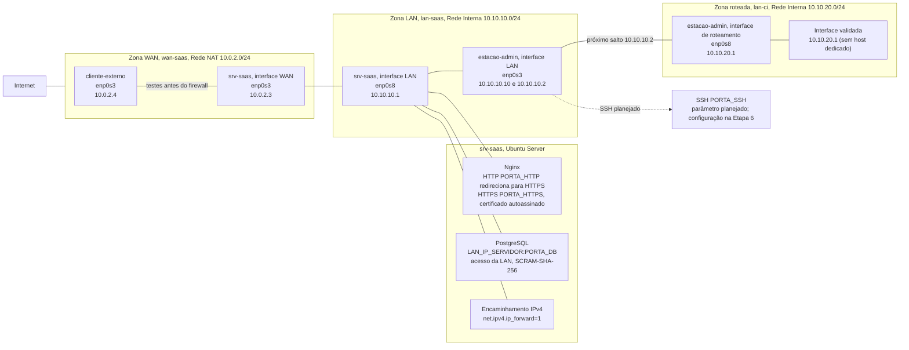

# Rede e serviços do laboratório

## Objetivo e pré-condições

A Etapa 2 fixa os endereços antes de qualquer regra de firewall, instala uma
página HTTPS de demonstração e disponibiliza PostgreSQL somente na LAN. Os
scripts usam `config/lab.env` como fonte de endereços, interfaces, portas e
parâmetros configuráveis.

Antes de aplicar a rede, confirme no VirtualBox que os adaptadores estão nas
redes descritas em [laboratorio.md](./laboratorio.md). Os endereços WAN
`10.0.2.3` e `10.0.2.4` foram inicialmente obtidos por DHCP. Para esta
execução, a faixa DHCP de `wan-saas` foi ajustada para começar em `10.0.2.4`,
excluindo `10.0.2.3` antes de fixá-lo no `srv-saas`. Se a faixa DHCP ou a Rede
NAT mudar, confira novamente o endereço estático para evitar conflito com
outro convidado. O gateway e os resolvedores foram testados pela WAN.

Valores usados nesta execução em `config/lab.env`:

| Variável | O que definir ou conferir |
|---|---|
| `DNS_SERVERS` | `8.8.8.8,1.1.1.1`, observados na interface WAN e testados |
| `NETPLAN_TRY_TIMEOUT` | `120` segundos, prazo padrão para confirmar a configuração no console |
| `TLS_CERT_DAYS` | `365` dias para o certificado autoassinado de uso local |
| `IPV4_FORWARD` | `1`, valor exigido para encaminhar pacotes no servidor |

`TLS_COMMON_NAME`, `TLS_CERT_PATH`, `TLS_KEY_PATH`, `DB_NAME` e `DB_USER` já
estão preenchidas em `config/lab.env` com nomes locais de demonstração. Não
coloque senhas nesse arquivo. A senha aleatória de PostgreSQL é criada durante
a execução e guardada somente em `/root/.saas-db-senha`, com permissão `600`.
Para identificar os resolvedores recebidos atualmente por DHCP, carregue o
arquivo de parâmetros no servidor e consulte a interface WAN:

```bash
source config/lab.env
resolvectl dns "$IFACE_WAN"
```

Escolha em `DNS_SERVERS` somente endereços IPv4 efetivamente observados e
alcançáveis na Rede NAT.

## Modelo Netplan, explicado linha a linha

O arquivo [01-netcfg.yaml.tmpl](../../infra/netplan/01-netcfg.yaml.tmpl) é um
modelo, não um arquivo pronto para o Netplan. `scripts/aplica-rede.sh` lê
`config/lab.env`, calcula o prefixo a partir de `LAN_REDE` e `WAN_REDE`,
substitui as expressões `${VAR}` com `envsubst` e grava
`/etc/netplan/01-netcfg.yaml`.

| Linha ou campo | Explicação |
|---|---|
| `network:` | Inicia a definição de rede reconhecida pelo Netplan |
| `version: 2` | Seleciona o formato atual da configuração do Netplan |
| `renderer: networkd` | Entrega a configuração de interfaces ao `systemd-networkd`, apropriado para Ubuntu Server |
| `ethernets:` | Agrupa as interfaces Ethernet por nome |
| `${IFACE_LAN}:` | Usa a interface LAN observada no servidor, sem presumir seu nome |
| `dhcp4: false` | Desativa DHCP IPv4 nessa interface para manter o endereço LAN estável |
| `${LAN_IP_SERVIDOR}/${LAN_PREFIX}` | Atribui ao servidor o endereço LAN e o prefixo derivado de `LAN_REDE` |
| `routes:` na LAN | Declara a rota estática para a rede atrás de `estacao-admin` |
| `to: ${ROTA_ESTATICA_REDE}` | Identifica a rede de destino da rota estática |
| `via: ${ROTA_ESTATICA_VIA}` | Identifica o próximo salto LAN, `estacao-admin` |
| `${IFACE_WAN}:` | Usa a interface WAN observada no servidor |
| `dhcp4: false` | Evita que uma nova concessão DHCP substitua o endereço estático WAN |
| `${WAN_IP_SERVIDOR}/${WAN_PREFIX}` | Atribui o IP WAN e o prefixo derivado de `WAN_REDE` |
| `to: default` | Declara a rota padrão para destinos sem rota mais específica |
| `via: ${WAN_GATEWAY}` | Envia tráfego externo ao gateway WAN definido em `config/lab.env` |
| `nameservers:` | Configura resolvedores DNS para consultas de nomes |
| `addresses: [${DNS_SERVERS}]` | Insere a lista de endereços IPv4, separados por vírgula no arquivo de parâmetros |

O script cria um backup de `/etc/netplan` em `/var/backups` antes de trocar os
arquivos YAML. Se a validação ou `netplan try` falhar, tenta restaurar os
arquivos anteriores e reaplicar a configuração salva. Execute-o pelo console
local da VM, não por SSH: `netplan try` exige confirmação e permite reverter a
mudança se a conectividade não voltar.

## Rotas esperadas

Depois de confirmar `netplan try`, compare `ip -br addr` e `ip route` com a
tabela. Os endereços abaixo são os valores observados e registrados em
`config/lab.env`; se a rede do VirtualBox mudar, confira os valores antes de
tratar esta tabela como resultado esperado.

| Tipo | Destino | Próximo salto ou interface | Significado |
|---|---|---|---|
| Rede conectada WAN | `10.0.2.0/24` | `enp0s3`, endereço `10.0.2.3` | A WAN está diretamente ligada à Rede NAT |
| Rota default | `default` | `10.0.2.1` pela interface `enp0s3` | Caminho para destinos não cobertos por rotas mais específicas |
| Rede conectada LAN | `10.10.10.0/24` | `enp0s8`, endereço `10.10.10.1` | A LAN está diretamente ligada ao servidor |
| Rota estática | `10.10.20.0/24` | `10.10.10.2` pela interface `enp0s8` | Encaminha tráfego destinado a `lan-ci` para `estacao-admin` |

Uma rede conectada é alcançada diretamente pela interface indicada, sem
próximo salto. Uma rota estática é configurada pelo administrador e informa
destino e próximo salto. O próximo salto, também chamado `next hop`, é o
roteador vizinho que encaminhará o pacote em direção à rede de destino. A rota
default é usada quando nenhuma rota mais específica corresponde ao destino.

`scripts/aplica-rede.sh` também grava `net.ipv4.ip_forward=1` em
`/etc/sysctl.d/99-saas-forward.conf` e executa `sysctl --system`. Isso permite
que o servidor encaminhe pacotes entre interfaces. A estação administrativa,
que roteia entre `lan-saas` e `lan-ci`, também precisa estar com encaminhamento
IPv4 ativo para os pacotes atravessarem esse segundo salto. Este script não
altera a configuração persistente da estação.

## Topologia detalhada



O diagrama representa endereços observados. A interface WAN tem endereço
obtido por DHCP no estado inicial; a aplicação estática depende da conferência
da reserva ou faixa DHCP no VirtualBox. Nginx escuta nas portas HTTP e HTTPS
definidas em `config/lab.env`; o PostgreSQL é vinculado somente ao endereço LAN
do servidor. As portas e seu escopo nesta etapa são:

| Serviço | Parâmetro e valor atual | Escopo |
|---|---|---|
| HTTP | `PORTA_HTTP`, `80` | Nginx recebe e redireciona para HTTPS |
| HTTPS | `PORTA_HTTPS`, `443` | Nginx apresenta o certificado autoassinado |
| PostgreSQL | `PORTA_DB`, `5432` | Somente `LAN_IP_SERVIDOR`, autorizado pela LAN em `pg_hba.conf` |
| SSH | `PORTA_SSH`, `22022` | Parâmetro do laboratório; o serviço será configurado na Etapa 6 |

As portas de Nginx são configuradas sem endereço de bind específico e podem
responder pelas interfaces WAN e LAN enquanto não houver firewall. PostgreSQL
fica vinculado somente ao endereço LAN. Não há host dedicado conectado a
`lan-ci`; a conectividade validada alcança a interface `10.10.20.1` do
roteador.

## Execução e testes passo a passo

### 1. Conferir os dados e manter o firewall fora desta etapa

No console do `srv-saas`, abra a pasta compartilhada do repositório, edite
`config/lab.env` para definir `DNS_SERVERS`, `NETPLAN_TRY_TIMEOUT` e
`TLS_CERT_DAYS`, e confira interfaces, endereços, gateway e portas:

```bash
grep -E '^(IFACE_|LAN_|WAN_|ROTA_ESTATICA_|DNS_SERVERS=|NETPLAN_TRY_TIMEOUT=|TLS_CERT_DAYS=|PORTA_|IPV4_FORWARD=)' config/lab.env
```

Confirme no VirtualBox que `WAN_IP_SERVIDOR` não está concedido a outra VM.
Não aplique regras de firewall ainda. Se houver uma configuração própria de
iptables que não seja a padrão inicial do laboratório, registre-a e confirme
com a equipe antes de prosseguir.

### 2. Aplicar IPs, rotas e encaminhamento

No console local do servidor, dentro da pasta do repositório:

```bash
sudo bash scripts/aplica-rede.sh
```

`netplan try` pede confirmação. Confira no mesmo console que o endereço WAN,
o acesso ao gateway e a rota default continuam corretos antes de aceitar. Se
perder conectividade ou não confirmar, aguarde a reversão automática.

Após aceitar, confira o arquivo final, sua permissão, endereços, rotas e
encaminhamento:

```bash
sudo stat -c '%a %n' /etc/netplan/01-netcfg.yaml
sudo netplan generate
source config/lab.env
ip -br addr
ip route
sysctl net.ipv4.ip_forward
ip route get "$IP_ROTEADOR_REDE_ROTEADA"
ping -c 4 "$WAN_GATEWAY"
ping -c 4 "$ROTA_ESTATICA_VIA"
getent hosts archive.ubuntu.com
```

O arquivo Netplan deve ter permissão `600`; o encaminhamento deve mostrar
`net.ipv4.ip_forward = 1`. A consulta de rota para `10.10.20.1` deve indicar
`10.10.10.2` como próximo salto. O ping a `10.10.20.1` pode ser testado depois
de confirmar o encaminhamento e a interface da estação; ele testa a interface
do roteador, não um host atrás dela. `getent` deve resolver o nome consultado,
confirmando que o resolvedor informado em `DNS_SERVERS` está acessível.

### 3. Instalar Nginx e PostgreSQL

Com o acesso WAN e DNS confirmados, execute no servidor:

```bash
sudo bash scripts/instala-servicos.sh
```

O script instala `nginx`, `postgresql` e `openssl`, cria a página estática e o
certificado autoassinado, configura o redirecionamento HTTP para HTTPS e
reinicia os serviços. PostgreSQL deve mostrar somente `LAN_IP_SERVIDOR` em
`listen_addresses`; a regra de senha do `pg_hba.conf` deve limitar-se a
`LAN_REDE` e usar `scram-sha-256`.

Confira os serviços e o bind:

```bash
sudo systemctl is-active nginx postgresql
sudo ss -lntp
source config/lab.env
sudo -u postgres psql -tAc 'SHOW listen_addresses; SHOW port;'
sudo -u postgres psql -d postgres -c 'SELECT line_number, type, database, user_name, address, auth_method, error FROM pg_hba_file_rules;'
curl -I "http://$LAN_IP_SERVIDOR:$PORTA_HTTP"
curl -k "https://$LAN_IP_SERVIDOR:$PORTA_HTTPS"
PGPASSWORD="$(sudo cat /root/.saas-db-senha)" psql -h "$LAN_IP_SERVIDOR" -p "$PORTA_DB" -U "$DB_USER" -d "$DB_NAME" -c 'SELECT current_user, current_database();'
unset PGPASSWORD
```

O HTTP deve responder com redirecionamento para HTTPS. `curl -k` é usado
somente porque o certificado é autoassinado. Na saída de `ss`, PostgreSQL deve
estar vinculado ao IP LAN, e não a `0.0.0.0` ou ao IP WAN. A consulta
`pg_hba_file_rules` não deve mostrar erro de sintaxe e deve conter a regra
SCRAM somente para a LAN e a base de demonstração. O último comando conecta
por TCP ao endereço LAN, autentica a conta de exemplo e não imprime a senha;
não registre o valor de `/root/.saas-db-senha` em evidências.

### 4. Registrar o Nmap antes do firewall

Antes de criar ou aplicar regras de firewall, use o `cliente-externo` para
capturar a linha de base das portas dos serviços:

```bash
source config/lab.env
date
nmap -Pn -sT -p "$PORTA_HTTP,$PORTA_HTTPS,$PORTA_DB" "$WAN_IP_SERVIDOR"
```

Guarde a captura como evidência com host, usuário, data e comando legíveis.
HTTP e HTTPS são os serviços previstos na interface WAN; PostgreSQL não deve
escutar no endereço WAN. Registre o resultado real do Nmap, sem presumir o
estado de portas que não foram testadas.

### 5. Confirmar persistência e preparar o snapshot

Depois de validar a configuração, reinicie `srv-saas` pelo sistema e repita
`ip -br addr`, `ip route` e `sysctl net.ipv4.ip_forward`. Em seguida, refaça
os testes HTTP, HTTPS e PostgreSQL. Se algum serviço não voltar, use o console
e consulte os backups que os scripts informaram em `/var/backups`.

Com a rede, os serviços e a evidência Nmap antes do firewall conferidos, crie
no VirtualBox o snapshot `pre-firewall`. Não aplique o firewall até que essa
captura esteja salva e a equipe tenha revisado o resultado.

## Limites e valores registrados

- `DNS_SERVERS`, `NETPLAN_TRY_TIMEOUT` e `TLS_CERT_DAYS` foram definidos como
  `8.8.8.8,1.1.1.1`, `120` e `365`, respectivamente.
- `WAN_IP_SERVIDOR=10.0.2.3` foi excluído da faixa DHCP, que começa em
  `10.0.2.4`, antes da configuração estática.
- No `srv-saas`, `enp0s3` foi confirmada como WAN e `enp0s8` como LAN; os
  endereços e rotas persistiram após reinício.
- `IP_ROTEADOR_REDE_ROTEADA` e `ROTA_ESTATICA_VIA` foram configurados na
  estação na preparação temporária. Confirme que seus endereços e o
  encaminhamento IPv4 da estação continuam ativos depois de reiniciar.
- A senha de exemplo não é publicada em evidências, capturas, logs ou no Git.
- Os scripts não instalam nem configuram firewall. A regra de não aplicar o
  firewall antes da evidência Nmap preserva a linha de base exigida na Etapa 2.
